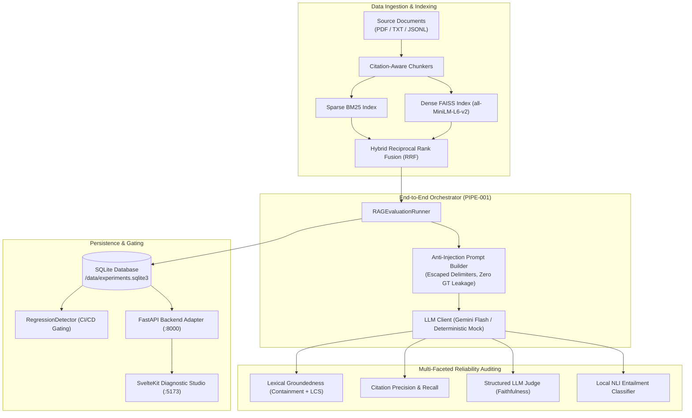

# AI Reliability Lab

Industrial-grade reliability, evaluation, and regression testing platform for document-based AI and Retrieval-Augmented Generation (RAG) architectures.

[](https://github.com/dpr2106/ai-reliability-lab/actions)
[](LICENSE)
[](https://www.python.org/)
[](https://github.com/astral-sh/ruff)
[](https://mypy-lang.org/)
[](https://github.com/dpr2106/ai-reliability-lab)

---

## Overview

AI Reliability Lab provides a production-grade infrastructure to evaluate retrieval quality, verify document groundedness, audit inline citations, detect subtle pipeline regressions, and visually debug failure modes in document-based AI applications.

### The Problem
Generative AI and RAG systems fail in silent, compounding ways:
- **Retrieval Blindspots**: Sparse lexical search misses paraphrased passages; dense vector search blurs exact alphanumeric identifiers and technical formulas.
- **Hallucinations**: Language models generate plausible but unsupported claims absent from the retrieved evidence.
- **Citation Drift**: Inline citations (`[CHK-xxx]`) often cite irrelevant chunks or hallucinate sources not present in the context.
- **Silent Regressions**: Pipeline modifications (chunking strategies, embedding models, prompt versions) pass basic unit tests while quietly degrading accuracy.

### The Solution
AI Reliability Lab replaces subjective inspection with baseline-first Information Retrieval (IR) benchmarking, multi-faceted post-generation auditing (containment, LCS, NLI, and structured judging), automated CI/CD regression gating, and an interactive diagnostic studio.

For the comprehensive technical evaluation and deep-dive empirical analysis, read the [Architecture Case Study & Benchmark Report](docs/CASE_STUDY.md).

---

## Key Capabilities

- **Citation-Aware Document Ingestion**: PDF and text chunking with deterministic character offsets, token bounds, and provenance tracking (Fixed, Sentence, Sliding Window, Recursive).
- **Sparse, Dense & Hybrid Retrieval**:
  - Okapi BM25 with Robertson-Spärck Jones IDF and deterministic tie-breaking.
  - Dense vector retrieval with FAISS (`IndexFlatIP`) and Sentence Transformers (`all-MiniLM-L6-v2`).
  - Hybrid Reciprocal Rank Fusion (RRF, $k=60$) combining sparse and dense rankings without score normalization fragility.
- **Cranfield IR Metrics**: Hand-calculated ranking metrics: Recall@K, Precision@K, Hit Rate@K, MRR@K, NDCG@K, and latency percentiles (P50, P90, P95, P99).
- **Lexical Groundedness Auditing**: Fast local evaluation measuring sentence-level token containment and Longest Common Subsequence (LCS) ratios against source chunks without external API dependencies.
- **Citation Precision & Recall**: Inline citation tag parsing (`[CHK-xxx]`, `[CIT-xxx]`), candidate set resolution, and precision/recall calculations.
- **Local NLI & Structured LLM Judging**: Cross-encoder NLI entailment classification paired with schema-validated `LLMJudge` faithfulness scoring and directional Pearson/Spearman correlation analysis.
- **End-to-End Pipeline Orchestrator**: Reusable backend orchestration (`RAGEvaluationRunner`) executing retrieval, generation, groundedness, citation auditing, judging, and persistence in a single call.
- **Automated CI/CD Regression Gating**: `RegressionDetector` comparing candidate runs against baseline experiments with configurable tolerances and deterministic exit codes.
- **Diagnostic Studio**: Interactive dark-themed SvelteKit 3 / Svelte 5 frontend with client-side run filtering, side-by-side regression diffing, and citation auditing.
- **Containerized Deployment**: Multi-stage Dockerfiles and Docker Compose topology with non-root security and persistent SQLite named volume storage.

---

## Architecture Overview



---

## Empirical Benchmark Results

Evaluated against the canonical benchmark dataset (25 corpus chunks, 16 benchmark queries, $K=5$):

| Metric / Dimension | Okapi BM25 | Dense FAISS (Flat IP) | Hybrid RRF ($k=60$) | Primary Advantage |
|---|---|---|---|---|
| **Recall@5** | 0.8542 | 0.9479 | **0.9688** | Hybrid achieves highest total evidence coverage. |
| **Precision@5** | 0.3500 | 0.3875 | **0.4000** | RRF prioritizes multi-source agreed items. |
| **Hit Rate@5** | 1.0000 | 1.0000 | 1.0000 | All three place $\ge 1$ relevant chunk in top-5. |
| **MRR@5** | 0.9688 | **1.0000** | 0.9688 | Dense retrieval placed relevant chunk at rank 1 for all queries. |
| **NDCG@5** | 0.9113 | **0.9548** | 0.9494 | Dense and Hybrid significantly outperform lexical baseline. |
| **P50 Latency** | **0.0921 ms** | 34.2345 ms | 35.2590 ms | BM25 is ~360× faster than CPU neural vector generation. |
| **Index Build Time** | **3.33 ms** | 848.90 ms | 743.68 ms | BM25 indexes in milliseconds without weight loading. |

> **Dataset & Methodology Note**: The bundled benchmark contains 25 corpus chunks and 16 evaluation queries. While sufficient to verify algorithmic correctness, scoring formulas, and semantic trade-offs, results reflect this dataset size and should not be generalized as universal claims across multi-million-document collections. Query latencies represent P50 across 5 warm repetitions per query (80 total runs per retriever); index build time is measured once during initial corpus indexing.

---

## Quickstart

### 1. Containerized Quickstart (Docker & Docker Compose)
Run the entire platform (FastAPI backend + SvelteKit frontend + SQLite storage) without configuring Python or Node locally:

```bash
# Clone the repository
git clone https://github.com/dpr2106/ai-reliability-lab.git
cd ai-reliability-lab

# Boot the application in the background
docker compose up --build -d

# Check service status
docker compose ps
```

- **Frontend Diagnostics Studio**: [http://localhost:5173](http://localhost:5173)
- **FastAPI Interactive Docs**: [http://localhost:8000/docs](http://localhost:8000/docs)
- **Health Check**: [http://localhost:8000/api/health](http://localhost:8000/api/health)

Run automated container tests and benchmarks:
```bash
# Run backend test suite, mypy, and ruff checks
docker compose run --rm tests

# Execute reproducible retrieval and RAG benchmarks
docker compose run --rm benchmark

# Stop services (preserves SQLite persistent volume)
docker compose down
```

---

### 2. Local Python Development Setup

```bash
# Create and activate virtual environment
python -m venv .venv
source .venv/bin/activate  # On Windows: .\.venv\Scripts\activate

# Install core and development dependencies
pip install -e .[dev]

# Optional: Install dense retrieval & NLI packages
pip install -e .[dense,nli]

# Run quality checks and tests
ruff check .
ruff format --check .
mypy reliability_lab
pytest
```

---

### 3. Local Diagnostic Studio (FastAPI + SvelteKit)

#### Terminal 1: Backend Adapter
```bash
export RELIABILITY_LAB_DB=".reliability-lab/experiments.sqlite3"
uvicorn reliability_lab.api.main:app --reload --port 8000
```

#### Terminal 2: SvelteKit Frontend
```bash
cd frontend
npm ci
npm run dev
```

Visit `http://localhost:5173` to access:
- **Run Explorer** (`/`): Search, filter, and inspect historic runs.
- **Run Diagnostics** (`/runs/[run_id]`): Drill down into query-level failure traces and citation breakdowns.
- **Run Comparison** (`/compare`): Side-by-side regression diffing with interactive tolerance controls.
- **Citation Audit** (`/citation-audit`): Verify inline citations against retrieved candidates.

---

## Command-Line Interface (CLI)

The `reliability-lab` CLI supports automated benchmarking and CI regression gating:

### 1. Run Retrieval Benchmark (`run-benchmark`)
```bash
reliability-lab run-benchmark \
  --corpus data/benchmarks/sample_corpus.jsonl \
  --dataset data/benchmarks/sample_benchmark.jsonl \
  --database .reliability-lab/experiments.sqlite3 \
  --top-k 5 \
  --experiment-name bm25-baseline
```

### 2. Run End-to-End RAG Evaluation (`run-rag-evaluation`)

**Using Local Ollama Inference (Offline AI)**:
```bash
reliability-lab run-rag-evaluation \
  --corpus data/benchmarks/sample_corpus.jsonl \
  --dataset data/benchmarks/sample_benchmark.jsonl \
  --database .reliability-lab/experiments.sqlite3 \
  --top-k 5 \
  --llm-provider ollama \
  --model llama3.2 \
  --experiment-name local-ollama-rag
```

**Using Deterministic Mock (CI / Hermetic Testing)**:
```bash
reliability-lab run-rag-evaluation \
  --corpus data/benchmarks/sample_corpus.jsonl \
  --dataset data/benchmarks/sample_benchmark.jsonl \
  --database .reliability-lab/experiments.sqlite3 \
  --top-k 5 \
  --llm-provider mock \
  --model gemini-2.5-flash \
  --experiment-name mock-rag-run
```

**Using Cloud Gemini Inference**:
```bash
export GEMINI_API_KEY="your-api-key"
reliability-lab run-rag-evaluation \
  --corpus data/benchmarks/sample_corpus.jsonl \
  --dataset data/benchmarks/sample_benchmark.jsonl \
  --database .reliability-lab/experiments.sqlite3 \
  --top-k 5 \
  --llm-provider gemini \
  --model gemini-2.5-flash \
  --experiment-name gemini-rag-run
```

### 3. Automated Regression Gating (`assert-regression`)
```bash
reliability-lab assert-regression \
  --baseline <baseline-run-id> \
  --candidate <candidate-run-id> \
  --database .reliability-lab/experiments.sqlite3 \
  --tolerance 0.02
```

Deterministic exit codes for CI:
- `0`: **PASS** — No metrics degraded beyond tolerance.
- `1`: **REGRESSION** — One or more aggregate or query metrics regressed beyond tolerance.
- `2`: **INCOMPLETE** — Query set mismatch prevented clean comparison.
- `3`: **ERROR** — Missing run ID, invalid parameters, or storage error.

---

## Local Inference with Ollama (Offline AI)

AI Reliability Lab v2 supports 100% offline, privacy-preserving AI generation and evaluation using **[Ollama](https://ollama.com)**. No data leaves your machine, no external API keys are required, and inference incurs zero cloud costs.

### 1. Prerequisites & Setup
1. **Install Ollama**:
   - macOS / Linux: `curl -fsSL https://ollama.com/install.sh | sh`
   - Windows: Download the installer from [ollama.com/download/windows](https://ollama.com/download/windows).
2. **Start the Ollama daemon**:
   ```bash
   ollama serve
   ```
3. **Pull your preferred model**:
   ```bash
   # Default recommended compact model (3B parameters)
   ollama pull llama3.2

   # Alternative models supported out-of-the-box
   ollama pull mistral
   ollama pull qwen2.5:7b
   ollama pull deepseek-r1:8b
   ```

### 2. Configuration Environment Variables
| Variable | Default | Description |
|---|---|---|
| `OLLAMA_BASE_URL` | `http://localhost:11434` | Ollama daemon HTTP endpoint |
| `OLLAMA_MODEL` | `llama3.2` | Default model tag when `--model` is omitted |

### 3. Running RAG Evaluation Locally
```bash
reliability-lab run-rag-evaluation \
  --corpus data/benchmarks/sample_corpus.jsonl \
  --dataset data/benchmarks/sample_benchmark.jsonl \
  --database .reliability-lab/experiments.sqlite3 \
  --top-k 5 \
  --llm-provider ollama \
  --model llama3.2 \
  --experiment-name local-llama3.2-eval
```

---

## LLM Provenance: Mock vs. Local Ollama vs. Cloud Gemini

AI Reliability Lab strictly tracks model provenance across every evaluation to ensure synthetic data is never confused with authentic AI inference:

- **Local Ollama Inference (`is_mock=False`, `provider="ollama"`)**:
  - Genuine local neural inference executing via Ollama daemon (`llama3.2`, `mistral`, etc.).
  - 100% offline, zero cloud API keys, zero network data transmission.
  - Generates document-grounded answers with real model reasoning and citation tags.
  - Token evaluation metrics (`prompt_eval_count`, `eval_count`) and latency accurately captured.
- **Deterministic Mock Execution (`is_mock=True`, `provider="mock"`)**:
  - Deterministic test double generating rule-based synthetic answers and pre-canned judge scores.
  - Zero network calls; 100% reproducible for CI pipelines, hermetic unit tests, and quick regressions.
  - Flagged explicitly as `is_mock=True` in SQLite database records, CLI banners, and UI summaries.
- **Live Cloud Gemini Execution (`is_mock=False`, `provider="gemini"`)**:
  - Live inference via Google Gemini API (`gemini-2.5-flash`).
  - Requires `GEMINI_API_KEY` in environment; fails fast if credentials are not configured.
  - Displays explicit live cloud provenance in all reports.

---

## Technical Stack

| Layer | Technologies & Libraries |
|---|---|
| **Core Domain** | Pure Python 3 standard library dataclasses (`reliability_lab.core`) |
| **Ingestion** | PyMuPDF (`fitz`), Python standard regex, character segmentation |
| **Retrieval** | Okapi BM25, FAISS (`faiss-cpu`), Sentence Transformers (`all-MiniLM-L6-v2`) |
| **Language Models** | Google Gemini API (`httpx`), Abstract provider-independent client |
| **Storage & Gating** | SQLite3 (WAL mode), pure SQL schema migrations, `RegressionDetector` |
| **API Backend** | FastAPI, Uvicorn, Pydantic v2 |
| **Frontend Studio** | SvelteKit 3, Svelte 5 (Runes), TypeScript, Vite 8, `@sveltejs/adapter-node` |
| **Packaging & CI** | Docker, Docker Compose, GitHub Actions (Python 3.11 & 3.12 matrices) |
| **Code Quality** | Ruff (linting & formatting), Mypy (strict type-checking), Pytest, Vitest |

---

## Key Architecture Decision Records (ADRs)

The platform is designed following strict Architecture Decision Records documented in [`docs/DECISIONS.md`](docs/DECISIONS.md):
- **ADR-005: Pure Standard-Library Core Domain Layer**: Eliminates third-party framework churn in fundamental business logic.
- **ADR-007: Rebase-Only Merge Policy with Linear Git History**: Preserves granular, reviewable atomic commits on `main`.
- **ADR-008: Decoupled SvelteKit Diagnostic Studio & FastAPI Backend Adapter**: Replaces Streamlit with a responsive, high-performance web interface.
- **ADR-009: Provider-Independent Abstract LLM Client Architecture**: Pluggable interface supporting live Gemini generation and deterministic offline mocks.
- **ADR-010: Schema-Validated LLM Judge with Strict Citation Provenance and NLI Alignment**: Directionally aligned correlation between LLM judges and local NLI cross-encoders.
- **ADR-011: Unified End-to-End RAG Evaluation Pipeline Orchestration**: Zero ground-truth prompt leakage and prominent mock provenance tracking.
- **ADR-012: Multi-Stage Containerization & Adapter-Node Topology**: Minimal non-root containers with persistent SQLite volume durability.
- **ADR-013: Local LLM Inference Provider Integration via Ollama HTTP API**: 100% offline local LLM generation and judging with zero cloud dependencies or API costs.

---

## Testing & Reliability

The platform enforces 100% test pass rates and strict quality gates on every commit:
- **Python Backend Suite**: **648 passed, 1 warning** across Python 3.11, 3.12, and 3.13.
- **Package Coverage**: **93%** line coverage across `reliability_lab`.
- **Static Quality**: 0 errors on `ruff check .`, 100% formatted via `ruff format`, 0 issues on `mypy reliability_lab`.
- **Frontend Suite**: 0 errors on `svelte-check --tsconfig ./tsconfig.json`, 6/6 unit tests passed via Vitest, clean production build via `@sveltejs/adapter-node`.
- **Hermetic CI**: Mandatory GitHub Actions matrix (`test-and-lint (3.11)` and `test-and-lint (3.12)`) gates every pull request before rebase merge.

---

## Future Roadmap

1. **Public Benchmark Ingestion**: Adapters for BEIR, MS MARCO, and HotpotQA datasets.
2. **Learned Sparse Embeddings**: SPLADE and BM25 term expansion support.
3. **Cross-Encoder Reranking**: Second-stage rerankers (BGE-Reranker, Cohere Rerank).
4. **Quantized Vector Indices**: FAISS `IndexIVFPQ` and HNSW-32 memory benchmarking for scale $> 10^6$ chunks.

---

## License

Apache License 2.0. See [LICENSE](LICENSE) for details.
